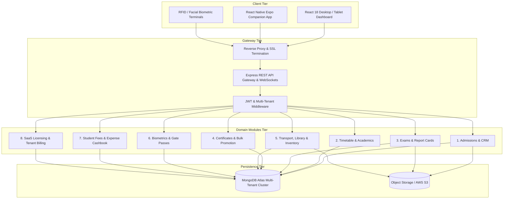

# CLASSTECH SCHOOL ERP SAAS — MODULE ARCHITECTURE & ROADMAP

**Document Version:** 2.0.0  
**Target Platform:** Multi-Tenant Web Administration Dashboard & Cross-Platform Mobile Application  
**Target Audience:** School Owners, Academic Administrators, Platform Engineers, Hardware System Integrators

---

## 1. System Architecture Overview

ClassTech is engineered on a unified multi-tenant architecture designed to manage the complete institutional lifecycle of K-12 schools, coaching institutes, and higher education academies.

---

## 2. Institutional Lifecycle Data Pipeline

ClassTech eliminates data silos by passing records through a unified lifecycle:

```mermaid
flowchart LR
    Enquiry[Lead / Enquiry] --> Application[Admission Application]
    Application --> Student[Enrolled Student Record]
    Student --> DailyOps[Timetable, Attendance & Bus Route]
    DailyOps --> Exams[Mid-Term / Final Exams]
    Exams --> ReportCard[Branded Report Card]
    ReportCard --> Promotion[Bulk Progression & Promotion]
    Promotion --> Certificate[Bonafide / TC Certificate]
    Certificate --> Alumni[Alumni Network]
```

1. **Lead Generation & CRM:** Inquiries gathered online or at the reception desk funnel into the CRM pipeline.
2. **Admissions Workflow:** Candidate submits details, uploads identity documents, takes entrance assessment, and undergoes interview.
3. **One-Click Enrollment:** Upon approval, the application converts directly into a student record, assigning roll numbers, GR numbers, and parent authentication credentials.
4. **Active Academic Operations:** Students attend scheduled classes, punch in via RFID turnstiles, board transport buses with stop-level manifests, borrow library books, and complete digital assignments.
5. **Continuous Assessment:** Faculty records theory/practical marks; the system generates CBSE or standard grade calculations and issues PDF report cards with institutional watermarks.
6. **Academic Year Progression:** At term-end, students are batch-promoted or retained with previous academic histories archived.
7. **Graduation & Alumni:** Departing students receive automated digital Transfer Certificates (TC) and transition into the searchable Alumni registry.

---

## 3. Module Breakdown & Enterprise Capabilities

### Module 1: Admissions CRM & Enrollment
- Pipeline funnel: `New` -> `Contacted` -> `Interview Scheduled` -> `Approved` -> `Converted to Student`.
- Entrance test scoring and structured faculty interview notes.
- Automatic roll number and GR number sequencing.
- Duplicate prevention by national ID or verified mobile phone.

### Module 2: Timetable & Substitute Teacher Management
- Real-time conflict engine preventing teacher, classroom, or batch double-booking.
- Automated substitute teacher finder factoring in current staff workload and approved leaves.
- Substitution overlay with approval workflows and push alerts to substitute teachers.

### Module 3: Examinations & Branded Report Cards
- Configurable grading schemes: Standard Distinction/First Class vs CBSE 9-Point Scale.
- Branded printable report cards including school crest, attendance percentage, and principal signature.
- Bulk marks CSV import engine with validation against maximum theory and practical marks.

### Module 4: Certificates & Student Progression
- Institutional certificate issuance: Bonafide, Transfer Certificate (TC), Study Certificate, Character Certificate.
- Unique tamper-resistant tracking format (`CERT-YYYY-XXXX`) and revocation logging.
- Year-end bulk promotion with academic history preservation.

### Module 5: Transport & Fleet Management
- Vehicle registry with fitness, insurance, and pollution certificate expiry monitoring.
- Route creation with GPS device identifiers, designated stops, and pickup/drop timings.
- Bus manifest generation for drivers and attendants with emergency contacts.

### Module 6: Library & Catalog Management
- Accession number and ISBN-indexed book catalogue.
- Borrower limits and automated overdue fine calculation engine (configurable daily rate).
- Student mobile self-service catalogue search and active loans view.

### Module 7: Inventory, Assets & Procurement
- Multi-category asset catalogue (IT equipment, laboratory consumables, stationery).
- Purchase orders (`PO-YYYY-XXXX`) with automated stock replenishment on goods receipt.
- Strict negative-stock prevention rules on material issuance.

### Module 8: School Calendar & Parent-Teacher Meetings (PTM)
- Academic calendar with multi-audience permissions (`All`, `Staff Only`, `Students & Parents`).
- Dynamic PTM slot scheduling by teachers and instant booking by parents with double-booking prevention.

### Module 9: Communication Centre & Circulars
- Official circular publication with circular tracking numbers.
- Mandatory acknowledgement collection from parents and students with timestamped audit logs.

### Module 10: ID Cards, Visitors & Gate Passes
- Student and staff digital ID cards featuring high-density QR/barcodes.
- Visitor management desk: Badge issuance, host staff notification, and check-out recording.
- Student early exit gate passes with security gate departure verification.

### Module 11: RFID & Biometric Integration
- Hardware terminal registry for RFID turnstiles, fingerprint readers, and face terminals.
- Raw punch ingestion endpoint with a 5-minute debounce algorithm to discard double-taps.
- Instant WebSocket push notifications to parent mobile apps when students pass security gates.

### Module 12: Student Documents & Compliance Vault
- Storage for mandatory documents (Aadhaar, birth certificate, vaccination history).
- Compliance checklist tool highlighting missing documents across batches.

### Module 13: Alumni Management
- Graduated student directory with employment, higher education, and location records.
- Student privacy controls allowing public directory opt-in/opt-out.
- One-click CSV directory export for academic boards and alumni associations.

### Module 14: SaaS Subscription & Platform Billing
- Strict partition between school revenue (student fees) and ClassTech software licensing.
- Tiered per-student licensing plans (`Basic Tier`, `Pro Growth`, `Enterprise Multi-Branch`).
- Automatic 14-day trial provisioning for new school registrations.

### Module 15: School Expenses & Operating Cashbook
- Comprehensive expense voucher entry with category classification and receipt attachments.
- School operating cashbook aggregating total tuition fee collections vs operating costs (salaries, utilities, maintenance) for real-time Net Operating Surplus.

### Module 17: Support, Helpdesk & Health Monitoring
- Multi-tenant support ticketing with priority routing (`Critical`, `High`, `Medium`).
- Real-time system health telemetry monitoring MongoDB Atlas ping, latency, and memory consumption.

---

## 4. Cross-Cutting Engineering Concerns

### Multi-Tenancy Isolation
Every schema contains an indexed `instituteId` field referencing `Institute`. API routes extract `instituteId` exclusively from the authenticated JWT token—never from request query strings or client payloads. This guarantees cross-tenant isolation at the database index layer.

### Role-Based Access Control (RBAC)
ClassTech enforces strict role separation:
- `superadmin`: Global SaaS administration, institute provisioning, platform subscription plans.
- `owner` / `admin`: School principal, management, and IT administrator access.
- `teacher`: Marks entry, batch attendance, timetable review, homework creation, PTM scheduling.
- `staff` / `librarian` / `guard`: Specialised operational access (library, inventory, security gate pass).
- `student` / `parent`: Read-only access to attendance, fee payments, report cards, and circulars.

---

## 5. Implementation & Rollout Roadmap

| Milestone | Modules Included | Status | Key Deliverables |
|---|---|---|---|
| **Phase 1: Core Foundation** | Multi-Tenancy, Auth, Students, Batches, Attendance, Fees | ✅ Completed | Production multi-tenant database, React dashboard, mobile OTP login. |
| **Phase 2: Academic & LMS** | Notes, Homework, Live Classes, Quizzes, Grievances, Vault | ✅ Completed | Timed auto-graded quizzes, chunked large file vault, staff payroll. |
| **Phase 3: Advanced Operations** | Modules 1–15, 17 (Admissions, Timetable, Exams, Transport, Library, Inventory, Calendar, Gate Passes, Biometrics, Documents, Alumni, SaaS Billing, Expenses, Support) | ✅ Completed | All 26 automated integration tests passing, Vite frontend bundle compiled. |
| **Phase 4: Ecosystem Scale** | Mobile Push Notifications (FCM), Native Biometric SDK bridge, AI Auto-Scheduling | 🚀 Upcoming (Q4 2026) | Firebase Cloud Messaging push, direct TCP sockets for eSSL/ZKTeco hardware controllers. |
